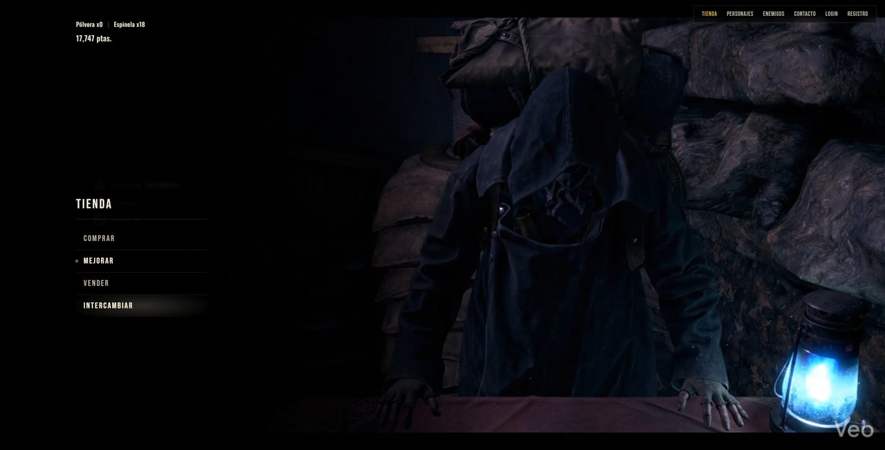

# Tienda del Buhonero (RE4)

Tienda full stack inspirada en el mercader de *Resident Evil 4 Remake*. El frontend está hecho en React y consume una API REST propia en Express con MongoDB. Tiene registro e inicio de sesión con JWT, roles de usuario y un panel de administración para manejar todo el catálogo.

**[Ver la demo](https://buhonero-re4-shop.vercel.app)** · API: `https://buhonero-api.onrender.com/api`



> La API corre en el plan gratuito de Render. Si estuvo un rato sin uso, el primer pedido tarda entre 30 y 60 segundos en despertarla.

## Qué tiene

- **Tienda pública:** catálogo de armas con filtro por categoría, detalle de cada arma, personajes y enemigos.
- **Cuentas:** registro e inicio de sesión con JWT. Las contraseñas se guardan hasheadas con bcrypt.
- **Roles:** cada usuario es `usuario` o `admin`, y el rol viaja dentro del token. Al registrarte sos usuario común; solo un admin puede cambiar roles.
- **Panel de administración** (`/admin`): alta, edición y baja de armas, personajes, enemigos y usuarios.
- **Rutas protegidas:** `/admin` pide sesión iniciada y rol de admin. Si no los tenés, te redirige.
- **Validaciones** en la API y en los formularios.
- **Navegación con teclado**, como en el juego: `Q` y `E` cambian de pestaña, `A` y `D` de categoría, y `Esc` vuelve al menú.

## Stack

| Parte | Tecnologías |
|---|---|
| Frontend | React 19, React Router, Vite, Tailwind CSS 4 |
| Backend | Node.js, Express (MVC), JWT, bcrypt |
| Base de datos | MongoDB con Mongoose (Atlas en producción) |
| Deploy | Vercel (frontend) y Render (API) |

## Cómo correrlo

Hace falta Node y una base MongoDB, local con Docker o en Atlas.

```bash
# Base de datos local (si no usás Atlas)
docker run -d -p 27017:27017 --name mongo-buhonero mongo:7

# API
cd backend
cp .env.example .env   # en URI_DB va la URI de tu base
npm install
npm run dev            # http://localhost:3000

# Frontend (en otra terminal, desde la raíz)
npm install
npm run dev            # http://localhost:5173
```

La primera vez que arranca, la API carga el catálogo y crea un usuario admin de prueba: `admin@buhonero.com` / `buhonero123`. Después, lo que se edite desde el panel queda guardado y no se pisa al reiniciar.

## API

| Método | Ruta | Acceso |
|---|---|---|
| POST | `/api/users` | público (registro) |
| POST | `/api/users/auth` | público (login, devuelve el JWT) |
| GET / PUT / DELETE | `/api/users`, `/api/users/:id` | admin |
| GET | `/api/weapons`, `/api/weapons/:id` | público |
| POST / PUT / DELETE | `/api/weapons`, `/api/weapons/:id` | admin |
| GET | `/api/personajes`, `/api/personajes/:id` | público |
| POST / PUT / DELETE | `/api/personajes`, `/api/personajes/:id` | admin |
| GET | `/api/enemigos`, `/api/enemigos/:id` | público |
| POST / PUT / DELETE | `/api/enemigos`, `/api/enemigos/:id` | admin |

Las rutas de admin esperan el token en el header `Authorization: Bearer <token>`.

## Estructura

```
src/
├── pages/        tienda, detalle, personajes, enemigos, login, registro y admin
├── components/   HUD, menú, pestañas, lista de armas y formularios del panel
├── context/      sesión del usuario (AuthContext)
├── router/       rutas y PrivateRoute
└── services/     todas las llamadas a la API
backend/src/
├── routes/ → controllers/ → models/
├── middlewares/  verificación del token y del rol
└── config/       conexión a la base y carga inicial
```

## Sobre el proyecto

Lo hice para la materia Aplicaciones Híbridas de Escuela Da Vinci. Empezó como una maqueta en React, con los wireframes armados antes en Pencil, y terminó como una app full stack con panel de administración y deploy.
